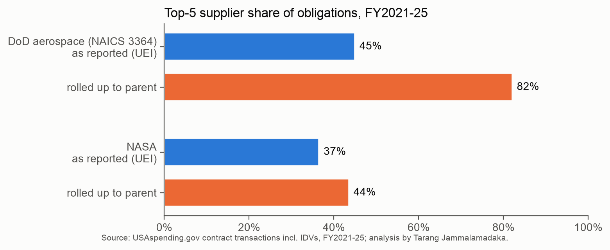

# Aerospace supplier spend (DoD + NASA, USAspending)

<!-- Hero card: rendered by tarang-tj/tarang-tj (node scripts/render-repo-hero.mjs aero docs/img), same number as the profile tile. -->
<picture>
  <source media="(prefers-color-scheme: dark)" srcset="docs/img/hero-dark.svg">
  <source media="(prefers-color-scheme: light)" srcset="docs/img/hero-light.svg">
  
</picture>

[](https://github.com/tarang-tj/aero-supplier-spend/actions/workflows/ci.yml)
[](https://tarang-tj.github.io/aero-supplier-spend/)
[](LICENSE)
[](https://www.usaspending.gov/)

**Who really gets paid to build U.S. military and NASA aerospace?** 874,769 real contract transactions, FY2021 to FY2025, $600.9B, reconciled to USAspending's own totals to the cent. Take the supplier records at face value and the top five DoD aerospace suppliers hold 45%. Roll them up to parent companies and it's 82%.



**[Live page](https://tarang-tj.github.io/aero-supplier-spend/)** · [Memo](docs/memo.pdf) · [Excel spend cube](docs/aero-supplier-spend.xlsx)

## Findings
1. **Supplier records hide half the concentration.** DoD's largest aerospace supplier record holds 21% of obligations; rolled up to parent companies, Lockheed Martin holds 43% and the top five hold 82% (HHI 2,360).
2. **Contract type follows the kind of work.** DoD puts 77% of aerospace dollars on fixed-price contracts but only 27% of R&D. NASA is 66% cost-type.
3. **Most DoD aerospace dollars are not competed:** 87%, mostly justified as only one source.
4. **One tier down, the same pattern:** in Boeing's reported subcontracts ($19.4B), the top record holds 8% but RTX across its units holds 17%.

## Scope
- Every NASA contract transaction, and every DoD transaction in NAICS 3364 (aerospace product and parts manufacturing).
- Award types A-D plus all IDV types. IDV obligations are 23.9% of NASA dollars; leaving them out silently undercounts.
- Obligations net of deobligations, by federal fiscal year of the action date. FY2026 is excluded (DoD data publishes with a 90-day delay).

## Reproduce
```
python3 -m venv .venv && .venv/bin/pip install -e ".[dev]" && .venv/bin/playwright install chromium
make pull      # 10 downloads from the USAspending API, about an hour
make subawards # Boeing's reported subcontracts via the per-award API (optional)
make all       # load, crosswalk, metrics, charts, workbook, page, then the gate
```
`make gate` runs ruff, pytest (fixtures plus tie-outs on the real outputs), the networked reconcile against USAspending, and a Playwright boot probe of the page at 1440 and 375 px.

## Method notes
- **Supplier rollup.** `data/crosswalk.csv` maps parent UEIs (and a few recipient UEIs) to parent companies. Subsidiary and acquisition rows cite a 10-K Exhibit 21, a company announcement or NSF's FFRDC list. Today's owner is applied to every year. USAspending's own parent field is recorded as of each action (Aerojet Rocketdyne moves under L3Harris in FY2024), so it cannot be used alone.
- **FFRDC flag.** The per-row flag misses JPL, so the crosswalk's NSF-sourced flag is used.
- **Pricing families** (USAspending data dictionary, FAR 16): fixed-price A,B,J,K,L,M; cost-reimbursement R,S,T,U,V; time and materials / labor hour Y,Z.
- **Competition:** not competed = B, C, G, NDO; follow-on to a competed action (E) is reported separately.
- **Boundary check:** a product-code definition of DoD aerospace gives a higher FY2025 top-five share (60% vs 52%), so NAICS 3364 is the conservative choice.
- HHI here measures concentration of one buyer's spend, not a market.

Data: USAspending.gov, public domain. Code: MIT.
